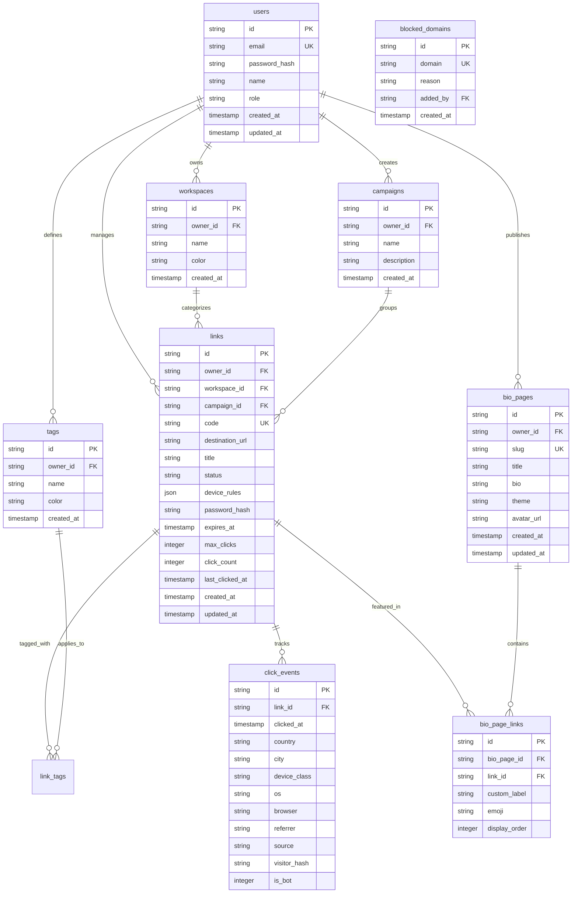

# 🗄️ Database Architecture & Data Dictionary — LinkPulse

```
========================================================================================
PROJECT          : LinkPulse (Next-Gen URL Infrastructure & Telemetry Route Engine)
DOCUMENT TYPE    : Database Architecture, ER Diagram & Complete Data Dictionary
DIALECTS         : PostgreSQL 15+ (Production) & SQLite 3 / node:sqlite (Local Dev)
VERSION          : 2.0.0
========================================================================================
```

---

## 1. Entity-Relationship (ER) Diagram



---

## 2. Complete Data Dictionary

### Table 1: `users`
Stores user identities, administrative roles, and credential hashes.
| Column | Type | Constraints | Description |
|:---|:---|:---|:---|
| `id` | `VARCHAR(36)` | PRIMARY KEY | Unique UUID or Nanoid identifier. |
| `email` | `VARCHAR(255)` | NOT NULL, UNIQUE | Normalized lowercase user email address. |
| `password_hash` | `VARCHAR(255)` | NOT NULL | `bcryptjs` salt + password hash (10 rounds). |
| `name` | `VARCHAR(100)` | NOT NULL | User's full display name. |
| `role` | `VARCHAR(20)` | NOT NULL, DEFAULT `'user'` | Role-based permission: `'user'` or `'admin'`. |
| `created_at` | `TIMESTAMP / TEXT` | NOT NULL | ISO-8601 creation timestamp. |
| `updated_at` | `TIMESTAMP / TEXT` | NOT NULL | ISO-8601 last modification timestamp. |

### Table 2: `workspaces` (Folders)
Provides folder-level organization for links.
| Column | Type | Constraints | Description |
|:---|:---|:---|:---|
| `id` | `VARCHAR(36)` | PRIMARY KEY | Unique workspace UUID. |
| `owner_id` | `VARCHAR(36)` | NOT NULL, FK `users(id)` ON DELETE CASCADE | Parent tenant user ID. |
| `name` | `VARCHAR(100)` | NOT NULL | Display name of folder. |
| `color` | `VARCHAR(20)` | DEFAULT `'#6366f1'` | UI folder badge hex color code. |
| `created_at` | `TIMESTAMP / TEXT` | NOT NULL | Timestamp when workspace was created. |

### Table 3: `campaigns`
Groups marketing short links for aggregate ROI and campaign reporting.
| Column | Type | Constraints | Description |
|:---|:---|:---|:---|
| `id` | `VARCHAR(36)` | PRIMARY KEY | Unique campaign UUID. |
| `owner_id` | `VARCHAR(36)` | NOT NULL, FK `users(id)` ON DELETE CASCADE | Parent tenant user ID. |
| `name` | `VARCHAR(100)` | NOT NULL | Campaign title (e.g., "Summer Launch 2026"). |
| `description` | `TEXT` | NULLABLE | Detailed campaign description. |
| `created_at` | `TIMESTAMP / TEXT` | NOT NULL | Timestamp of campaign creation. |

### Table 4: `tags` & `link_tags`
Enables multi-label classification across links.
| Column | Type | Constraints | Description |
|:---|:---|:---|:---|
| `id` | `VARCHAR(36)` | PRIMARY KEY | Unique tag UUID. |
| `owner_id` | `VARCHAR(36)` | NOT NULL, FK `users(id)` ON DELETE CASCADE | Parent tenant user ID. |
| `name` | `VARCHAR(50)` | NOT NULL | Tag label. |
| `color` | `VARCHAR(20)` | DEFAULT `'#f97316'` | UI tag chip hex color code. |
| `created_at` | `TIMESTAMP / TEXT` | NOT NULL | Creation timestamp. |

`link_tags` composite join table:
* `link_id` (`VARCHAR(36)` FK `links(id)` ON DELETE CASCADE)
* `tag_id` (`VARCHAR(36)` FK `tags(id)` ON DELETE CASCADE)
* `PRIMARY KEY (link_id, tag_id)`

### Table 5: `links`
The core URL record containing all 8-step routing parameters.
| Column | Type | Constraints | Description |
|:---|:---|:---|:---|
| `id` | `VARCHAR(36)` | PRIMARY KEY | Unique link UUID. |
| `owner_id` | `VARCHAR(36)` | NOT NULL, FK `users(id)` ON DELETE CASCADE | Creator user ID. |
| `workspace_id` | `VARCHAR(36)` | NULLABLE, FK `workspaces(id)` ON DELETE SET NULL | Folder assignment. |
| `campaign_id` | `VARCHAR(36)` | NULLABLE, FK `campaigns(id)` ON DELETE SET NULL | Associated campaign. |
| `code` | `VARCHAR(50)` | NOT NULL, UNIQUE | Custom alias or Base62 Nanoid slug. |
| `destination_url` | `TEXT` | NOT NULL | Default target destination URL. |
| `title` | `VARCHAR(255)` | NULLABLE | Descriptive title or web page name. |
| `status` | `VARCHAR(20)` | NOT NULL, DEFAULT `'active'` | State: `'active'`, `'disabled'`, `'expired'`. |
| `device_rules` | `JSON / TEXT` | DEFAULT `'{}'` | JSON object: `{ "ios": "...", "android": "...", "desktop": "..." }`. |
| `password_hash` | `VARCHAR(255)` | NULLABLE | `bcryptjs` hash if password protected. |
| `expires_at` | `TIMESTAMP / TEXT` | NULLABLE | ISO-8601 expiration cutoff. |
| `max_clicks` | `INTEGER` | NULLABLE | Strict maximum visitor quota. |
| `click_count` | `INTEGER` | NOT NULL, DEFAULT `0` | Total valid, non-bot click counter. |
| `last_clicked_at` | `TIMESTAMP / TEXT` | NULLABLE | Timestamp of most recent redirect. |
| `created_at` | `TIMESTAMP / TEXT` | NOT NULL | Link creation timestamp. |
| `updated_at` | `TIMESTAMP / TEXT` | NOT NULL | Timestamp of last setting modification. |

### Table 6: `click_events`
Asynchronously populated log of every visitor interaction.
| Column | Type | Constraints | Description |
|:---|:---|:---|:---|
| `id` | `VARCHAR(36)` | PRIMARY KEY | Unique click event UUID. |
| `link_id` | `VARCHAR(36)` | NOT NULL, FK `links(id)` ON DELETE CASCADE | Associated link. |
| `clicked_at` | `TIMESTAMP / TEXT` | NOT NULL | Exact UTC timestamp of click. |
| `country` | `VARCHAR(100)` | DEFAULT `'Unknown'` | Country resolved via `geoip-lite`. |
| `city` | `VARCHAR(100)` | DEFAULT `'Unknown'` | City resolved via `geoip-lite`. |
| `device_class` | `VARCHAR(30)` | DEFAULT `'desktop'` | Class: `'mobile'`, `'tablet'`, `'desktop'`. |
| `os` | `VARCHAR(50)` | DEFAULT `'Unknown'` | Operating System (iOS, Android, Windows, macOS). |
| `browser` | `VARCHAR(50)` | DEFAULT `'Unknown'` | Browser engine (Chrome, Safari, Firefox). |
| `referrer` | `VARCHAR(255)` | DEFAULT `'Direct'` | Referrer hostname or `'Direct'`. |
| `source` | `VARCHAR(50)` | DEFAULT `'direct'` | Tagged source (`'qr'`, `'bio'`, `'email'`, etc.). |
| `visitor_hash` | `VARCHAR(64)` | NOT NULL | One-way salted HMAC-SHA256 fingerprint. |
| `is_bot` | `INTEGER` | NOT NULL, DEFAULT `0` | Flag: `1` if user-agent matched crawler bot. |

### Table 7: `blocked_domains`
Global administrative blocklist preventing malicious phishing redirects.
| Column | Type | Constraints | Description |
|:---|:---|:---|:---|
| `id` | `VARCHAR(36)` | PRIMARY KEY | Unique UUID. |
| `domain` | `VARCHAR(255)` | NOT NULL, UNIQUE | Normalized bare domain (e.g., `phishing.xyz`). |
| `reason` | `VARCHAR(255)` | NULLABLE | Administrative justification for block. |
| `added_by` | `VARCHAR(36)` | FK `users(id)` ON DELETE SET NULL | Administrator user ID who issued block. |
| `created_at` | `TIMESTAMP / TEXT` | NOT NULL | Timestamp when domain was added. |

### Table 8: `bio_pages` & `bio_page_links`
Hosts public creator profile landing hubs (`/bio/:slug`).
| Column | Type | Constraints | Description |
|:---|:---|:---|:---|
| `id` | `VARCHAR(36)` | PRIMARY KEY | Unique bio page UUID. |
| `owner_id` | `VARCHAR(36)` | NOT NULL, FK `users(id)` ON DELETE CASCADE | Creator user ID. |
| `slug` | `VARCHAR(50)` | NOT NULL, UNIQUE | Public URL slug (`/bio/:slug`). |
| `title` | `VARCHAR(100)` | NOT NULL | Public header title or creator handle. |
| `bio` | `TEXT` | NULLABLE | Bio description paragraph. |
| `theme` | `VARCHAR(30)` | NOT NULL, DEFAULT `'dark'` | Preset theme (`dark`, `light`, `brand`, `sunset`, `ocean`). |
| `avatar_url` | `TEXT` | NULLABLE | Optional profile avatar image URL. |
| `created_at` | `TIMESTAMP / TEXT` | NOT NULL | Creation timestamp. |
| `updated_at` | `TIMESTAMP / TEXT` | NOT NULL | Last update timestamp. |

`bio_page_links` stores ordered buttons on the bio page:
* `id` (`VARCHAR(36)` PRIMARY KEY)
* `bio_page_id` (`VARCHAR(36)` FK `bio_pages(id)` ON DELETE CASCADE)
* `link_id` (`VARCHAR(36)` FK `links(id)` ON DELETE CASCADE)
* `custom_label` (`VARCHAR(100)` NOT NULL — Custom text shown on the button)
* `emoji` (`VARCHAR(10)` NULLABLE — Icon emoji placed before button text)
* `display_order` (`INTEGER` NOT NULL, DEFAULT `0` — Ascending order sequence)

---

## 3. High-Performance Indexing Strategy

To guarantee sub-millisecond query responses across tables holding millions of click events, the following B-Tree indexes are defined:

```sql
-- High-concurrency lookup for edge redirect engine
CREATE UNIQUE INDEX IF NOT EXISTS idx_links_code ON links(code);

-- Tenant ownership lookups
CREATE INDEX IF NOT EXISTS idx_links_owner ON links(owner_id);
CREATE INDEX IF NOT EXISTS idx_links_campaign ON links(campaign_id);
CREATE INDEX IF NOT EXISTS idx_links_workspace ON links(workspace_id);

-- Primary telemetry timeseries index (Composite B-Tree)
CREATE INDEX IF NOT EXISTS idx_clicks_link_time ON click_events(link_id, clicked_at);

-- Geographic & bot aggregation indexes
CREATE INDEX IF NOT EXISTS idx_clicks_link_country ON click_events(link_id, country);
CREATE INDEX IF NOT EXISTS idx_clicks_link_device ON click_events(link_id, device_class);
CREATE INDEX IF NOT EXISTS idx_clicks_link_bot ON click_events(link_id, is_bot);

-- Bio page fast resolution index
CREATE UNIQUE INDEX IF NOT EXISTS idx_bio_pages_slug ON bio_pages(slug);
CREATE INDEX IF NOT EXISTS idx_bio_links_order ON bio_page_links(bio_page_id, display_order);
```

---

## 4. Connection Pooling (PgBouncer Configuration)

In production deployments on Vercel and Supabase:
* **Direct Database Port (`5432`):** Spawns a dedicated PostgreSQL backend process per client. Under Vercel's serverless auto-scaling, this triggers `EMAXCONNSESSION` errors.
* **PgBouncer Transaction Pooler Port (`6543`):** Multiplexes hundreds of transient serverless functions across a tightly managed pool of 15 persistent database connections. Transactions are cleanly checked out and released instantly upon `COMMIT`, preventing pool exhaustion.
* **Network Requirement:** All production connection strings must use the IPv4 pooler host (`aws-0-[region].pooler.supabase.com`) with `?sslmode=require`.
