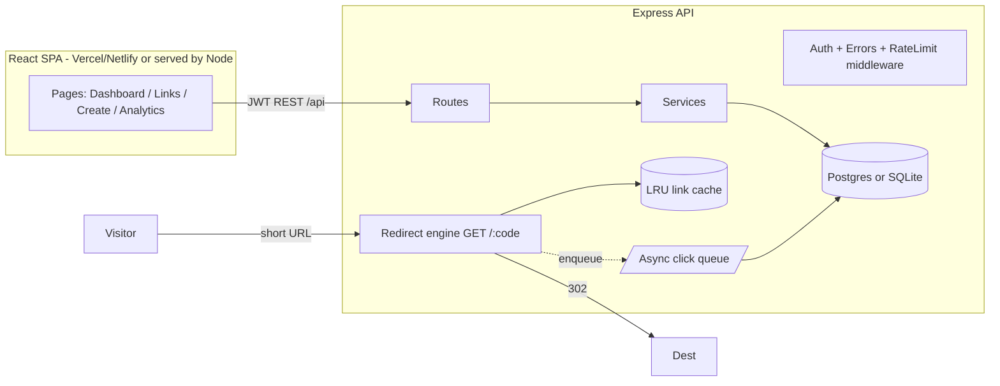
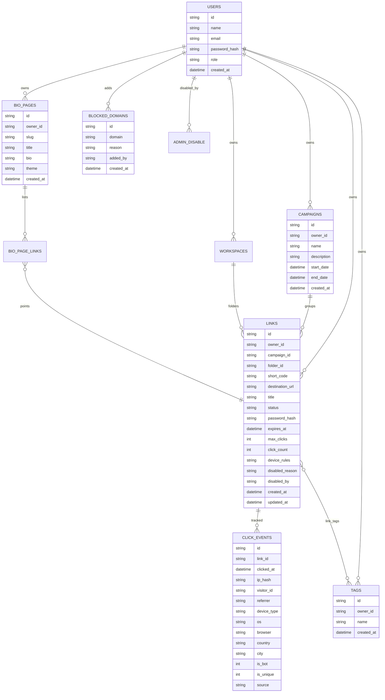
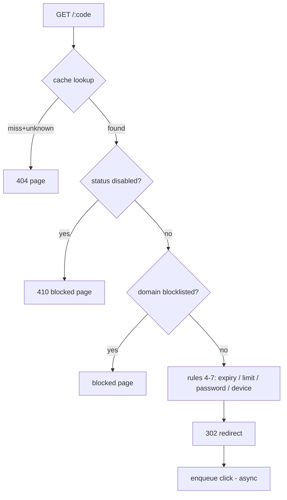

# LinkPulse — URL Shortener & Analytics Platform

Shorten URLs, share them (direct or via QR), and understand every click with
real-time analytics — built for a hackathon demo as a working, deployable full-stack app.

**Current status: ✅ All 4 phases complete & deploy-ready** (auth, create link, redirect
engine, async click tracking, link analytics, dashboard, campaigns/tags/folders, QR codes,
CSV bulk import, admin panel + blocklist, link-in-bio pages, device-targeting UI, alert
polish). See [ROADMAP.md](./ROADMAP.md) and [PHASES.md](./PHASES.md) for the phase-wise
build & verification record.

---

## Table of contents
- [Tech stack](#tech-stack)
- [Repository layout](#repository-layout)
- [Visual Architecture & Diagrams](./diagrams/README.md)
- [Quick start (local)](#quick-start-local)
- [Environment variables](#environment-variables)
- [Architecture](#architecture)
- [Data model / ER diagram](#data-model--er-diagram)
- [Redirect engine & rule order](#redirect-engine--rule-order)
- [Async click tracking](#async-click-tracking)
- [API reference](#api-reference)
- [Testing](#testing)
- [Seed data](#seed-data)
- [Deployment](#deployment)

---

## Tech stack
| Layer | Choice |
|------|--------|
| Backend | Node.js 24 (LTS) + Express 4 (ESM) |
| Database | PostgreSQL when `DATABASE_URL` is set; **built-in `node:sqlite`** fallback for local dev |
| Frontend | React 18 (Vite) + Tailwind CSS + Chart.js (react-chartjs-2) + React Router |
| Auth | JWT (`jsonwebtoken`) + `bcryptjs` |
| Click intelligence | `ua-parser-js`, `isbot`, `geoip-lite` |
| Validation | `zod` |
| Security | `helmet`, `cors`, `express-rate-limit` |
| IDs / codes | `nanoid` (base62 short codes, collision-safe) |

> **Note:** the spec listed `bcrypt`; we use the API-compatible pure-JS `bcryptjs`
> so installs need no native compiler on Windows/CI/Render. The spec's SQLite
> fallback uses Node's built-in `node:sqlite` (zero native deps).

## Repository layout
```
INNOVISTA-GEHU/
├─ diagrams/               # Visual architecture, ER & system flowcharts
│  ├─ README.md            # Diagrams directory index
│  ├─ SYSTEM_ARCHITECTURE.md # Full system context & layered components
│  ├─ DATABASE_ARCHITECTURE.md # 10-table ER model, FKs & indexes
│  └─ FLOW_DIAGRAMS.md     # 8-step redirect pipeline & async queue flows
├─ server/                 # Express API + redirect engine
│  ├─ src/
│  │  ├─ index.js          # entry: init db, start click queue, graceful shutdown
│  │  ├─ app.js            # middleware, route mounting, static SPA, error handling
│  │  ├─ config.js         # env-based config
│  │  ├─ db/               # dialect adapter + schema.{sqlite,pg}.sql (migrations)
│  │  ├─ middleware/       # auth (JWT/roles), errors (central handler)
│  │  ├─ services/         # authService, linkService, analyticsService, orgService,
│  │  │                    #   adminService, importService, bioService,
│  │  │                    #   cacheService (LRU), clickQueue (async batcher)
│  │  ├─ routes/           # auth, link, analytics, org, qr, admin, bio, redirect
│  │  ├─ utils/            # shortCode, validation (zod), clickContext, pages
│  │  └─ seed.js           # demo data generator
│  ├─ tests/               # node:test unit tests
│  ├─ scripts/smoke.mjs    # end-to-end API smoke test
│  └─ .env.example
├─ client/                 # React SPA (Vite + Tailwind + Chart.js)
│  ├─ src/{pages,components,lib}
│  ├─ .env.example
│  └─ vercel.json
├─ render.yaml             # Render blueprint (single-service deploy)
├─ netlify.toml            # Netlify config (frontend deploy)
├─ DEMO.md  ROADMAP.md
└─ README.md
```

## Quick start (local)
Requires **Node.js 24+** (for the built-in `node:sqlite` fallback and `--env-file`).

```bash
# 1. Backend
cd server
cp .env.example .env          # defaults work for local dev (SQLite fallback)
npm install
npm run seed                  # optional demo data
npm run clear                 # wipe all database tables (clean slate)
npm start                     # http://localhost:3001

# 2. Frontend (new terminal)
cd client
npm install
npm run dev                   # http://localhost:5173 (proxies /api -> :3001)
```

Open **http://localhost:5173** and sign in with a seeded account:

| Role | Email | Password |
|------|-------|----------|
| Admin | `admin@linkpulse.dev` | `admin1234` |
| User | `ada@example.com` | `password123` |
| User | `grace@example.com` | `password123` |

To use the same-origin single-service build (like production):
```bash
cd client && npm run build && cd ../server && npm start
# then open http://localhost:3001  (server serves client/dist + API + redirects)
```

## Environment variables
Backend (`server/.env`, see `server/.env.example`):

| Var | Required | Default | Purpose |
|-----|----------|---------|---------|
| `PORT` | no | `3001` | API/redirect listen port |
| `BASE_URL` | prod yes | `http://localhost:PORT` | Public short-link host; also used for self-reference detection |
| `CLIENT_ORIGIN` | no | `localhost:5173` | Comma-separated allowed CORS origins |
| `JWT_SECRET` | **prod yes** | dev-only warning | Token signing secret |
| `IP_HASH_SALT` | prod recommended | falls back to JWT secret | Salt for hashed IPs (raw IPs are **never** stored) |
| `DATABASE_URL` | no (Postgres) | unset → SQLite | Postgres connection string (`?sslmode=require` for Neon/Supabase) |
| `SQLITE_FILE` | no | `linkpulse.db` | SQLite path when no Postgres |
| `COOKIE_SECURE` | no | `false` | `true` on https (visitor-id cookie) |

Frontend (`client/.env`, see `client/.env.example`):

| Var | Default | Purpose |
|-----|---------|---------|
| `VITE_API_BASE` | `""` (Vite proxy in dev) | Backend origin for the split deploy |
| `VITE_SHORT_BASE` | `=VITE_API_BASE` | Host that serves short links (redirect engine) |

## Architecture
The backend is layered: **routes → services → db adapter**, with cross-cutting
**middleware** (auth, validation, central error handler) and **utils**.
The redirect hot path reads through an in-memory **LRU cache** and writes analytics
through an **async batched queue**, so redirects stay fast and never block on the DB.



## Data model / ER diagram
All tables are created idempotently at startup from `server/src/db/schema.{sqlite,pg}.sql`.
Primary keys are `nanoid` TEXT; timestamps are ISO-8601 UTC TEXT so the same SQL runs
on both engines. Foreign keys + indexes are defined in the schema.



## Redirect engine & rule order
`GET /:code` (`server/src/routes/redirectRoutes.js`) evaluates rules in a fixed,
documented order. **All rules 1–8 are wired** (Phase 2 activated expiry, click
limit, password and device targeting).

1. **Lookup** — cache-first (LRU, invalidated on update/disable). Not found → **404** page.
2. **Status disabled** → **410** page showing the disable reason.
3. **Destination on blocklist** → **blocked** page.
4. **Expiry passed** → link auto-marked expired (never deleted) → expired page (**410**).
5. **Click limit reached** → limit-reached page (**410**, fresh atomic count read).
6. **Password protected** → password form (**401**, bcrypt + short-lived signed cookie).
7. **Device targeting** → choose destination by OS/device (`device_rules` JSON).
8. **Redirect** → **302** (not 301, so analytics stay accurate) + async click log.



## Async click tracking
`server/src/services/clickQueue.js` decouples the redirect from persistence:
- The redirect handler calls `enqueueClick()` (fire-and-forget) **after** sending the 302.
- A background worker flushes every **1s** or when the queue hits **200**, in a
  transaction: unique-visitor check → batched `INSERT` → **atomic** per-link
  `click_count` bump (`UPDATE ... WHERE max_clicks IS NULL OR click_count < max_clicks`).
- **Durability:** flushes on `SIGINT`/`SIGTERM`, retries failed batches (up to 3×).
- **Bot filtering:** `isbot` + heuristics; bot rows are stored with `is_bot=1` but
  excluded from analytics counts and never bump `click_count`.
- **Privacy:** raw IPs are never stored — only a salted, truncated HMAC hash. A
  first-party `lp_vid` cookie supplies the unique-visitor key.

## API reference
Base: `/api`. Authenticated routes need `Authorization: Bearer <jwt>`.

| Method | Path | Auth | Description |
|--------|------|------|-------------|
| `GET` | `/api/health` | — | Liveness probe |
| `POST` | `/api/auth/register` | — | Create account (first account becomes admin) |
| `POST` | `/api/auth/login` | — | Login → `{ token, user }` |
| `GET` | `/api/auth/me` | ✅ | Current user |
| `POST` | `/api/links` | ✅ | Create link (rate-limited, fully validated) |
| `GET` | `/api/links` | ✅ | List own links — `?search=&status=&campaignId=&tagId=&folderId=&limit=&offset=` |
| `GET` | `/api/links/:id` | ✅ | Link detail (+ tags, campaign, folder) |
| `PATCH` | `/api/links/:id` | ✅ | Update settings — expiry, click limit, password (set/clear), campaign, folder, tags, device rules, status; busts redirect cache |
| `GET` | `/api/links/available?code=` | ✅ | Real-time alias availability |
| `POST` | `/api/links/validate` | ✅ | Dry-run wizard warnings (no publish) |
| `GET/POST/PATCH/DELETE` | `/api/campaigns[/:id]` | ✅ | Campaign CRUD + per-campaign stats |
| `GET/PATCH/DELETE` | `/api/tags[/:id]` | ✅ | Tag list w/ counts, rename, delete |
| `GET/POST/PATCH/DELETE` | `/api/folders[/:id]` | ✅ | Folder CRUD + link counts |
| `POST` | `/api/links/import/preview` | ✅ | Validate CSV rows (no writes) → per-row errors |
| `POST` | `/api/links/import` | ✅ | Import valid rows only → `{imported, failed}` report |
| `GET` | `/api/qr/:code.png` / `.svg` | — | QR code image for a short link (`?size=`, encodes `?src=qr`) |
| `GET` | `/api/admin/stats` / `/alerts` / `/links` / `/users` | 👑 | Platform analytics, abuse alerts, moderation lists |
| `POST` | `/api/admin/links/:id/disable\|enable` | 👑 | Disable with reason (instant, cache bust) / re-enable |
| `GET/POST/DELETE` | `/api/admin/blocklist[/:id]` | 👑 | Blocked-domain CRUD (subdomains inherit) |
| `GET/POST/PATCH/DELETE` | `/api/bio[/:id]` | ✅ | Link-in-bio page CRUD (slug, theme, ordered buttons) |
| `PUT` | `/api/bio/:id/links` | ✅ | Set the page's links + order + per-button label |
| `GET` | `/bio/:slug` | — | **Public** server-rendered bio page (clicks route through the engine `?src=bio`) |
| `GET` | `/api/analytics/dashboard?period=&campaignId=` | ✅ | Dashboard summary (metrics, timeseries, top links, geo) |
| `GET` | `/api/analytics/link/:id?period=` | ✅ | Full per-link analytics |
| `GET` | `/api/analytics/campaign/:id?period=` | ✅ | Campaign analytics |
| `GET` | `/api/analytics/alerts` | ✅ | Expiring-soon / near-limit / disabled / spike alerts |
| `GET` | `/:code` | — | **Redirect engine** (302 + tracking) |

`period` accepts `today | 7d | 30d | 90d`, or `from`/`to` ISO timestamps for custom ranges.

## Testing
```bash
cd server
npm test                      # node:test unit tests (alias, URL, self-ref, code
                              #   uniqueness, click-limit atomicity, bot exclusion,
                              #   device class, link settings/PATCH guards, blocklist,
                              #   CSV row validation, bio pages, redirect rule ORDER,
                              #   campaign-ownership + tags-only PATCH)
npm start &                    # then:
node scripts/smoke.mjs        # end-to-end: register->create->redirect->analytics->
                              #   rules 4-7->org CRUD->QR->import->admin moderation->
                              #   bio pages->device targeting->ownership invariant
```
Latest local results: **12/12 unit tests pass**, **smoke: all 73 assertions passed**.

## Seed data
```bash
cd server && npm run seed
```
Creates 3 users (1 admin), 3 campaigns, 3 folders, 4 tags, **20 links** (including a disabled,
an expired, a password-protected, a click-limited and a device-targeted one), a
link-in-bio page (`/bio/ada`) and ~3,900 realistic click events spread across 30 days
(bots, uniques, referrers, countries, devices, QR + bio sources). Seed logins are listed above.

## Deployment
Two supported shapes — both config-driven, no code changes.

### A) Single service on Render (recommended demo path)
Uses `render.yaml` — the Node service serves the SPA **and** API **and** redirects.
1. Push to GitHub → Render → **New → Blueprint** → select the repo.
2. Render auto-creates the web service. On first deploy set:
   - `BASE_URL` = your `https://<service>.onrender.com`
   - `CLIENT_ORIGIN` = same URL
   - `DATABASE_URL` = a Neon/Supabase Postgres URL (`?sslmode=require`)
3. Reopen the service → run the seed once against Postgres (`npm --prefix server run seed`).

> Render free tier disk is ephemeral: **SQLite data resets on restart**, so point
> `DATABASE_URL` at hosted Postgres before judging a "live" demo.

### B) Split: frontend on Vercel/Netlify + backend on Render/Railway
- **Backend**: deploy just `server/` on Render/Railway (same env vars, no client build).
- **Frontend**: `client/` on Vercel (`vercel.json`) or Netlify (`netlify.toml`), with
  build env `VITE_API_BASE=https://<backend>` and `VITE_SHORT_BASE=https://<backend>`.
- Set backend `CLIENT_ORIGIN=https://<frontend-url>` for CORS.

## Build order / phase status
- **Phase 1 (done):** auth, create link + validation wizard + real-time alias check,
  redirect engine (rules 1–3 + 8), async click tracking, link + dashboard analytics,
  seed, tests, deploy configs.
- **Phase 2 (done):** full redirect rules (expiry, atomic click limit page, password, device),
  complete create-wizard options, campaigns UI, tags/folders, dashboard filters.
- **Phase 3 (done):** QR codes (PNG/SVG, `?src=qr`), CSV bulk import with preview +
  error report, admin panel (disable-with-reason + blocklist CRUD), platform analytics,
  abuse alerts, click-limit/redirect-cache polish.
- **Phase 4 (done):** link-in-bio public pages (`/bio/:slug`, 5 themes, ordered buttons,
  `?src=bio` tracking), device-targeting UI in wizard + settings, dashboard alerts panel
  (messages + severity), seed realism, expanded tests (12 unit / 73 smoke).
