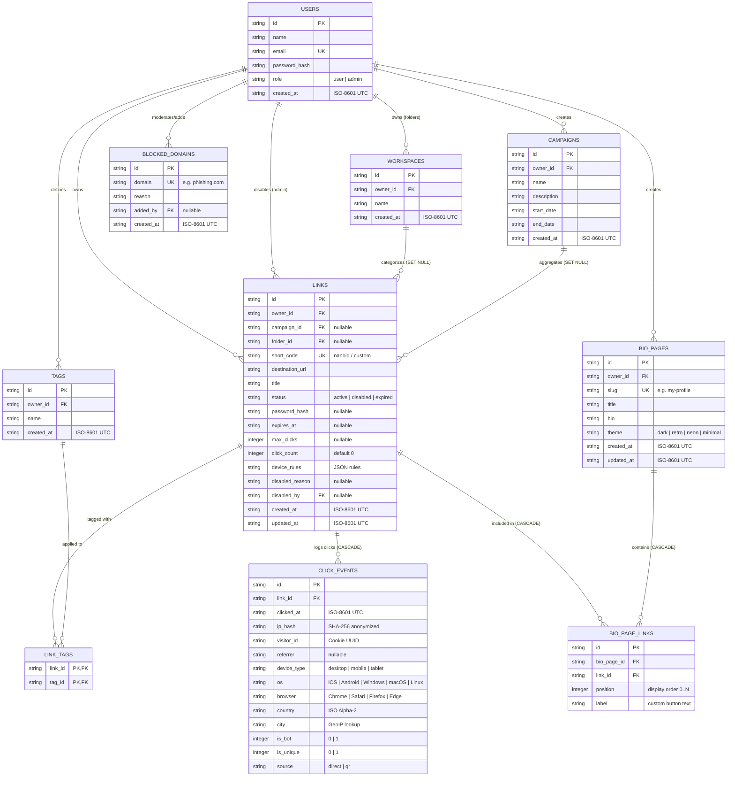
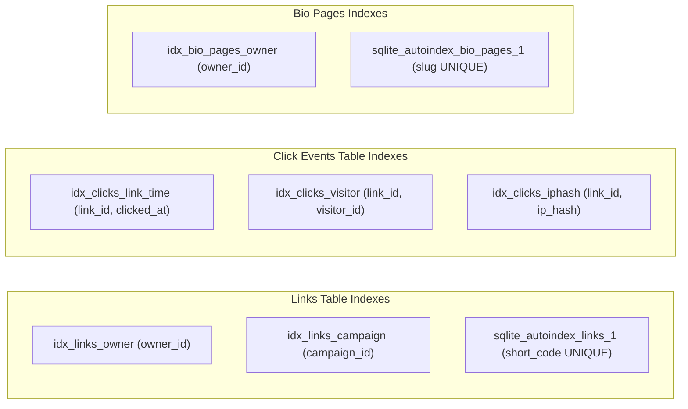

# Database Architecture & Entity Relationship (ER) — LinkPulse

Dokumentation LinkPulse platform ke relational database architecture, entity-relationship model, tables specification, indexes, foreign key cascade policies aur dual-dialect design ko detail me present karta hai.

---

## 1. Complete Entity-Relationship (ER) Diagram

---

## 2. Table Specifications & Cardinalities

### 2.1 Core Identity & Organization

#### `users`
Har account ka central profile record.
- **Constraints**: `email` is `UNIQUE NOT NULL`. `role` default `user` (or `admin`).
- **Cascade**: User deletion cascade se sabhi links, campaigns, workspaces, tags aur bio-pages delete karta hai.

#### `workspaces` (Folders)
Links ko hierarchical folders me group karne ke liye.
- **Relationship**: `users (1) -> workspaces (N)` (`ON DELETE CASCADE`).
- **Link Association**: Jab folder delete hota hai, `links.folder_id` automatically `SET NULL` ho jata hai (links safe rehte hain).

#### `campaigns`
Marketing campaigns with timeline metadata (`start_date`, `end_date`).
- **Relationship**: `users (1) -> campaigns (N)` (`ON DELETE CASCADE`).
- **Link Association**: `links.campaign_id` `ON DELETE SET NULL`.

#### `tags` & `link_tags`
M:N tagging system for high-dimensional filtering.
- **Constraint**: `UNIQUE(owner_id, name)` — har user ka tag name unique hota hai.
- **Junction**: `link_tags (link_id, tag_id)` composite primary key with cascade deletion on both ends.

---

### 2.2 Core Link & Traffic Tracking

#### `links`
System ka central entity jisme routing rules aur state store hoti hai.
- **`short_code`**: Unique indexed identifier (Base62 nanoid ya custom alias).
- **`status`**: State machine (`active` -> `disabled` -> `expired`).
- **`device_rules`**: JSON string (e.g. `{"ios": "https://apps.apple.com/...", "android": "https://play.google.com/..."}`).
- **`click_count`**: Denormalized atomic counter for ultra-fast limit checking without scanning millions of events.
- **Retention Rule**: Expired aur disabled links **kabhi bhi delete nahi kiye jaate**, ensuring historical analytics integrity!

#### `click_events`
High-volume append-only audit trail har single click ka.
- **`ip_hash`**: Privacy-compliant SHA-256 salted hash of visitor IP.
- **`visitor_id`**: 1-year first-party cookie (`lp_vid`) identifier.
- **`is_unique`**: In-transaction evaluated flag (whether this visitor_id or ip_hash has previously hit this link).
- **`is_bot`**: Filtered search engine crawler / monitoring bot flag.
- **`source`**: Traffic origin (`direct` click vs `qr` code scan).

---

### 2.3 Extension Features: Moderation & Bio-Pages

#### `blocked_domains`
Phishing, malware aur abusive destination domains ki global blocklist.
- Admin portal dwara managed.
- Subdomain matching capability (`badsite.com` blocks `phish.badsite.com`).

#### `bio_pages` & `bio_page_links`
Personalized "Link in Bio" mini-websites.
- `slug`: Public URL route (`/bio/:slug`).
- `position`: Integer for drag-and-drop sort order.
- Inactive links are dynamically filtered during public page rendering.

---

## 3. Database Indexes & Performance Optimization

| Index Name | Table | Columns | Purpose & Query Target |
|:---|:---|:---|:---|
| `idx_links_owner` | `links` | `(owner_id)` | Fast dashboard link list queries filter by user |
| `idx_links_campaign` | `links` | `(campaign_id)` | Fast campaign aggregation queries |
| `idx_clicks_link_time` | `click_events` | `(link_id, clicked_at)` | Time-series charting (24h / 7d / 30d analytics) |
| `idx_clicks_visitor` | `click_events` | `(link_id, visitor_id)` | Sub-millisecond unique visitor verification during batch ingest |
| `idx_clicks_iphash` | `click_events` | `(link_id, ip_hash)` | Cookie-less unique visitor verification fallback |
| `idx_bio_pages_owner` | `bio_pages` | `(owner_id)` | User bio page dashboard listing |

---

## 4. Dual-Dialect Compatibility Matrix

Dono SQL schemas ([schema.sqlite.sql](file:///c:/Users/ankus/Downloads/haldwani/server/src/db/schema.sqlite.sql) aur [schema.pg.sql](file:///c:/Users/ankus/Downloads/haldwani/server/src/db/schema.pg.sql)) 100% interoperable hain:

| Feature | SQLite Fallback | PostgreSQL Production | Adapter Normalization |
|:---|:---|:---|:---|
| Engine | Built-in Node 24 `node:sqlite` | `pg` connection pool | Unified `query()`, `queryOne()`, `run()`, `transaction()` |
| Param Placeholders | `?` | `$1, $2, $3...` | Automatic regex transformation `?` -> `$n` in adapter |
| Timestamps | `TEXT` (ISO-8601 UTC) | `TIMESTAMPTZ` / `TEXT` | Standardized ISO-8601 string formatting across app |
| Booleans | `INTEGER` (0 / 1) | `INTEGER` (0 / 1) or `BOOLEAN` | Normalized numeric boolean flags |
| Atomic Batch Update | `CASE WHEN ... THEN ... ELSE ... END` | `CASE WHEN ... THEN ... ELSE ... END` | Standard SQL without dialect-specific `MIN`/`LEAST` quirks |
