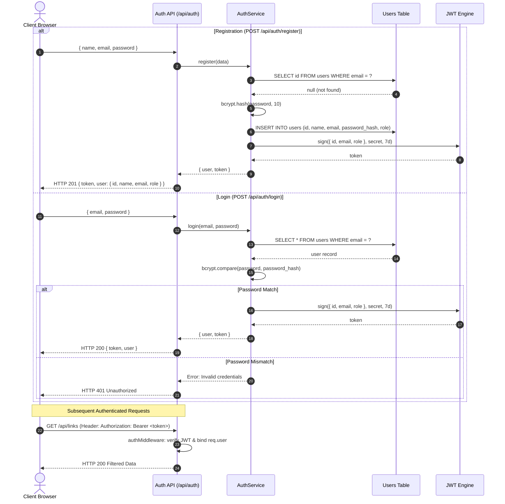
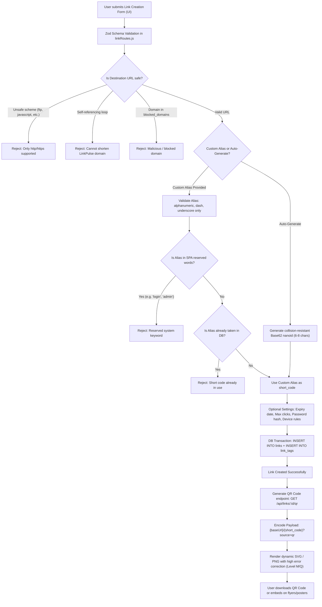
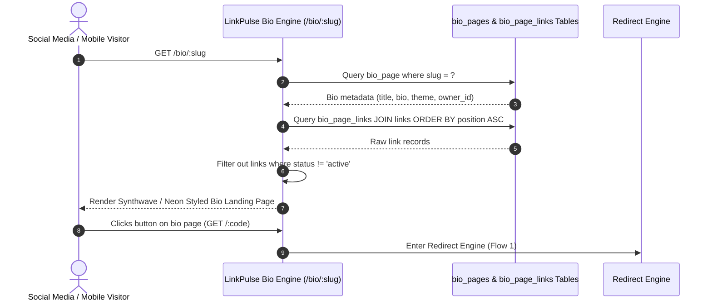
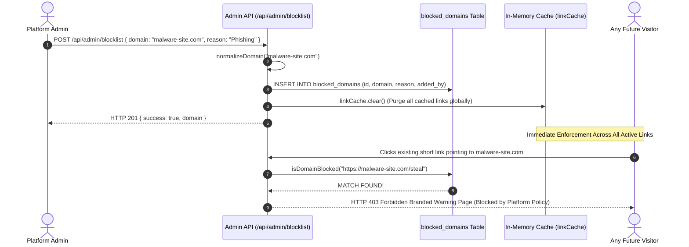

# System Flowcharts & Sequence Flows — LinkPulse

Dokumentation LinkPulse platform ke sabhi critical end-to-end execution workflows, decision trees aur sequence diagrams ko present karta hai.

---

## 1. Flow 1: Redirect Engine Decision Pipeline (8-Step Order)

Jab koi visitor short link request karta hai (`GET /:code`), redirect engine rules ko strictly defined order me evaluate karta hai:

```mermaid
flowchart TD
    Start(["Incoming Visitor Request: GET /:code"]) --> CheckReserved{"Is code reserved SPA word?<br>(login, dashboard, bio, etc.)"}
    CheckReserved -- Yes --> SPA["Pass through to Static SPA / Frontend Handler"]
    CheckReserved -- No --> Step1["Step 1: Cache Lookup (LRU)"]

    Step1 --> CacheHit{"Found in In-Memory LRU Cache?"}
    CacheHit -- Yes --> InspectLink["Evaluate Link Metadata"]
    CacheHit -- No --> QueryDB["Query DB: SELECT FROM links WHERE short_code = ?"]
    QueryDB --> Exists{"Link exists in DB?"}
    Exists -- No --> Page404["Return 404 Not Found Page (No-Store)"]
    Exists -- Yes --> SetCache["Store in LRU Cache"] --> InspectLink

    InspectLink --> Step2{"Step 2: Status Check<br>Is status == 'disabled'?"}
    Step2 -- Yes --> Page410Disabled["Return 410 Gone: Blocked Page with Admin Reason"]
    Step2 -- No --> Step3{"Step 3: Domain Blocklist<br>Is destination_url domain blocked?"}

    Step3 -- Yes --> Page403["Return 403 Forbidden: Phishing / Blocked Domain Page"]
    Step3 -- No --> Step4{"Step 4: Expiration Check<br>Has expires_at timestamp passed?"}

    Step4 -- Yes --> AutoExpire["Update links SET status = 'expired'<br>(Analytics preserved, never deleted!)"]
    AutoExpire --> BustCache["Invalidate LRU Cache"] --> Page410Expired["Return 410 Gone: Link Expired Page"]
    Step4 -- No --> Step5{"Step 5: Max Clicks Limit<br>Is max_clicks configured?"}

    Step5 -- Yes --> FreshCount["Fresh atomic read: SELECT click_count FROM links"]
    FreshCount --> LimitReached{"click_count >= max_clicks?"}
    LimitReached -- Yes --> BustCache2["Invalidate LRU Cache"] --> Page410Limit["Return 410 Gone: Click Limit Exceeded Page"]
    LimitReached -- No --> Step6
    Step5 -- No --> Step6{"Step 6: Password Protection<br>Is password_hash present?"}

    Step6 -- Yes --> HasCookie{"Has valid signed 12h<br>'lp_pw' JWT cookie?"}
    HasCookie -- No --> IsPost{"Is request HTTP POST<br>with password?"}
    IsPost -- No --> Page401["Return 401 Unauthorized: Terminal Password Entry Page"]
    IsPost -- Yes --> CheckBcrypt{"bcrypt.compareSync(attempt, hash)?"}
    CheckBcrypt -- No --> Page401Error["Return 401 Unauthorized: Invalid Password Prompt"]
    CheckBcrypt -- Yes --> SetPwCookie["Set signed 'lp_pw' HTTP-only cookie (12h)"] --> Step7
    HasCookie -- Yes --> Step7
    Step6 -- No --> Step7["Step 7: Device Targeting Rules"]

    Step7 --> ParseDevice["Detect Client Device Class (iOS / Android / Desktop)"]
    ParseDevice --> MatchRule{"Device rule defined for client class?"}
    MatchRule -- Yes --> OverrideURL["Override target = device_rules[deviceClass]"] --> Step8
    MatchRule -- No --> DefaultURL["Target = destination_url"] --> Step8

    Step8["Step 8: Final Redirection & Non-Blocking Logging"] --> IssueVisitorCookie["Issue 1-year first-party 'lp_vid' cookie if new"]
    IssueVisitorCookie --> Redirect302["HTTP 302 Found redirect to target<br>(Cache-Control: no-store)"]
    Redirect302 --> PushQueue["Fire-and-forget: enqueueClick(event)<br>Redirect is NOT delayed!"]
    PushQueue --> End(["Visitor Lands on Destination Website"])
```

---

## 2. Flow 2: Asynchronous Click Ingestion & Batch Queue

Click logging high-traffic redirects ko delay nahi karta. In-memory queue micro-batches me data persist karti hai:

```mermaid
sequenceDiagram
    autonumber
    actor Visitor as Web / QR Visitor
    participant Engine as Redirect Engine (redirectRoutes.js)
    participant Context as Click Context Enricher (clickContext.js)
    participant Queue as In-Memory Click Queue (clickQueue.js)
    participant DB as Relational Database (click_events & links)

    Visitor->>Engine: GET /:code
    Engine->>Context: buildClickEvent(req, link)
    activate Context
    Context->>Context: ua-parser-js -> parse OS, Browser, Device
    Context->>Context: geoip-lite -> lookup Country & City
    Context->>Context: isbot -> classify crawler vs human
    Context->>Context: SHA-256(ip + salt) -> generate ip_hash
    Context-->>Engine: enriched event object
    deactivate Context

    Engine-->>Visitor: HTTP 302 Redirect (immediate response!)
    Engine->>Queue: enqueueClick(event)

    Note over Queue: Events buffer in memory array.<br>Flush triggers every 1,000ms OR when queue >= 200

    rect rgb(20, 25, 45)
        Note over Queue,DB: Background Batch Worker Execution (flushOnce)
        Queue->>DB: BEGIN TRANSACTION
        loop For each event in batch
            Queue->>DB: SELECT 1 FROM click_events WHERE link_id=? AND (visitor_id=? OR ip_hash=?) LIMIT 1
            DB-->>Queue: Is unique visitor flag (0 or 1)
        end
        Queue->>DB: Bulk INSERT INTO click_events (all rows)
        Queue->>DB: Atomic Counter UPDATE links SET click_count = CASE ... WHERE id=?
        Queue->>DB: COMMIT TRANSACTION
    end
```

---

## 3. Flow 3: Authentication & Security Session Lifecycle

---

## 4. Flow 4: Link Creation & Dynamic QR Code Workflow

---

## 5. Flow 5: Link-in-Bio Page Delivery Flow

---

## 6. Flow 6: Admin Content Moderation & Domain Blocklist

