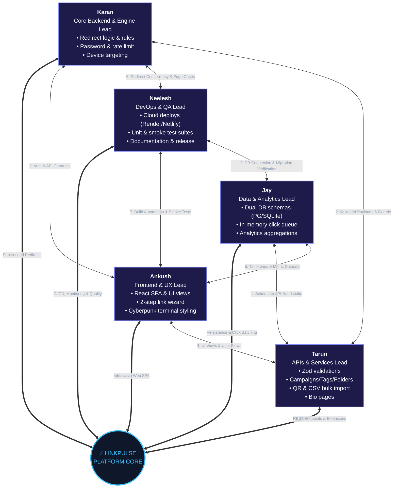
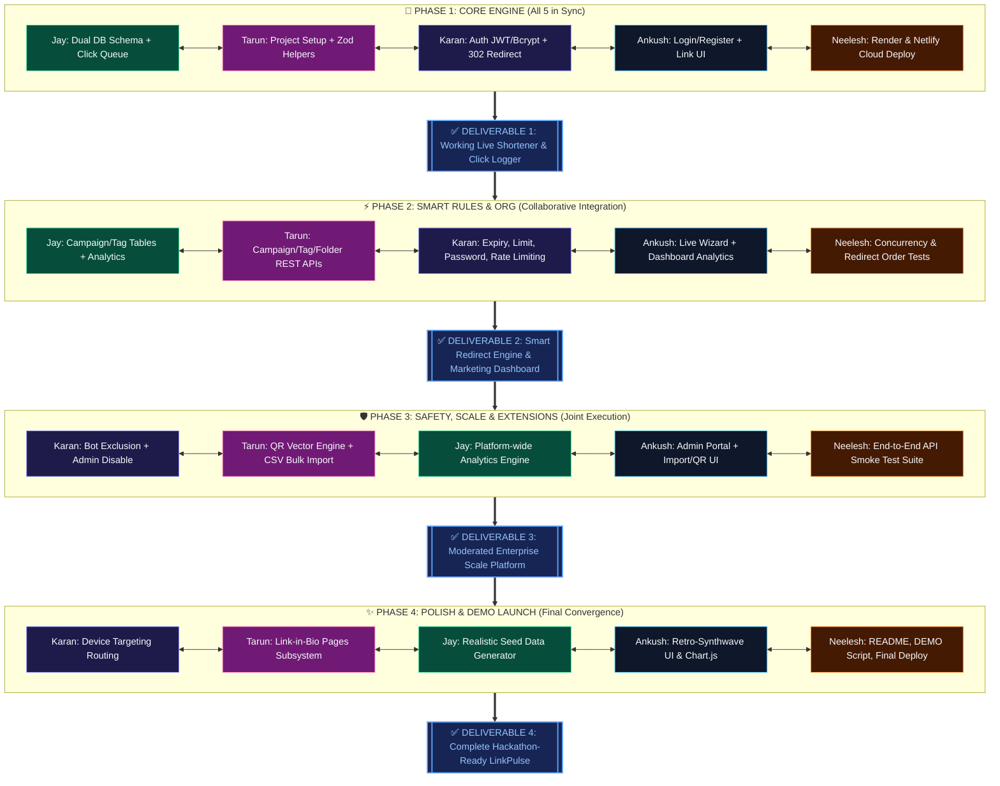
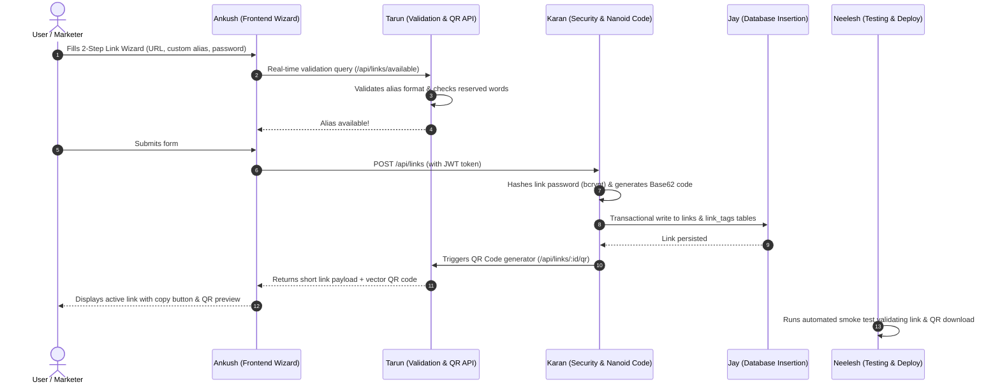
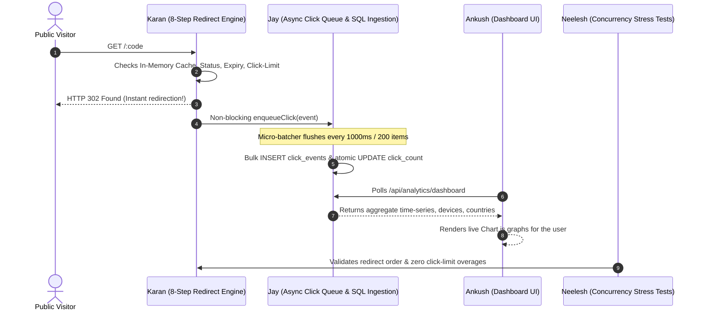
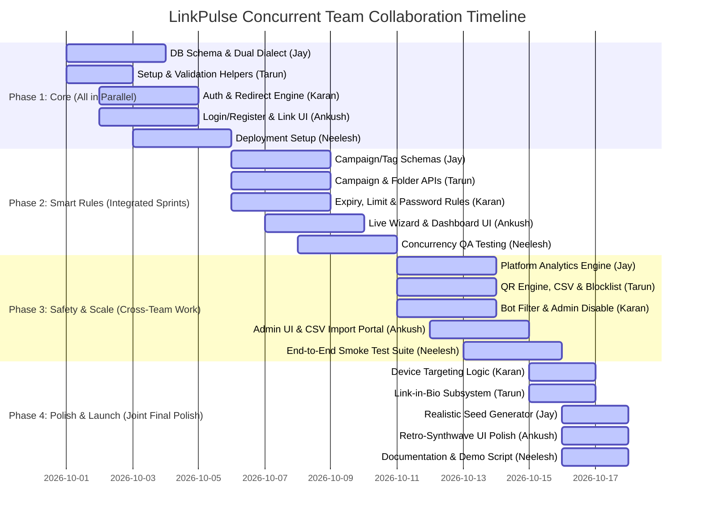

# Cross-Functional Team Collaboration & Implementation Roadmap — LinkPulse

Dokumentation LinkPulse project ke **5-Member Team Collaboration Model** (Karan, Ankush, Jay, Tarun, Neelesh) ko visual diagrams ke through showcase karta hai, jisme sabhi members isolated kaam karne ke bajay **saath me milkar (parallel & collaborative)** har phase aur feature deliver karte hain.

---

## 1. Unified Team Collaboration Hub (Cross-Functional Mesh)

Sabhi 5 members ek interconnected team mesh ki tarah kaam karte hain jahan har member ka output doosre members ke sath directly integrated hota hai:

---

## 2. Phase-by-Phase Collaborative Sprint Pods (All 5 Working Together)

Har phase me 5 members ek saath milkar parallelly ek cohesive milestone deliver karte hain:

---

## 3. Collaborative Feature Delivery Workflows

Yeh workflows dikhate hain ki real features ke development me sabhi team members ka continuous input kaise rehta hai:

### Workflow A: Link Creation & QR Code Generation

---

### Workflow B: High-Throughput Redirection & Analytics

---

## 4. Cross-Member Collaboration Matrix

| Collaboration Pair | Synergy & Shared Responsibilities | Codebase Files |
|:---|:---|:---|
| **Jay + Tarun** | Database schema design ko Zod schemas aur Express REST route handlers me translate karna. | [schema.sqlite.sql](file:///c:/Users/ankus/Downloads/haldwani/server/src/db/schema.sqlite.sql) ↔ [validation.js](file:///c:/Users/ankus/Downloads/haldwani/server/src/utils/validation.js) ↔ [orgRoutes.js](file:///c:/Users/ankus/Downloads/haldwani/server/src/routes/orgRoutes.js) |
| **Karan + Ankush** | Backend APIs aur Frontend client ke beech exact contract (Auth state, wizard data, link detail responses, error messages). | [authRoutes.js](file:///c:/Users/ankus/Downloads/haldwani/server/src/routes/authRoutes.js) ↔ [AuthPage.jsx](file:///c:/Users/ankus/Downloads/haldwani/client/src/pages/AuthPage.jsx) ↔ [CreateLink.jsx](file:///c:/Users/ankus/Downloads/haldwani/client/src/pages/CreateLink.jsx) |
| **Tarun + Ankush** | QR code downloads, CSV multipart file upload preview/import, aur Link-in-Bio pages ka frontend integration. | [qrRoutes.js](file:///c:/Users/ankus/Downloads/haldwani/server/src/routes/qrRoutes.js) ↔ [Import.jsx](file:///c:/Users/ankus/Downloads/haldwani/client/src/pages/Import.jsx) ↔ [Bio.jsx](file:///c:/Users/ankus/Downloads/haldwani/client/src/pages/Bio.jsx) |
| **Jay + Ankush** | Analytics SQL aggregations (hourly clicks, country codes, device OS) ko Chart.js visuals aur UI metric cards me wire karna. | [analyticsService.js](file:///c:/Users/ankus/Downloads/haldwani/server/src/services/analyticsService.js) ↔ [Dashboard.jsx](file:///c:/Users/ankus/Downloads/haldwani/client/src/pages/Dashboard.jsx) ↔ [LinkDetail.jsx](file:///c:/Users/ankus/Downloads/haldwani/client/src/pages/LinkDetail.jsx) |
| **Karan + Neelesh** | Redirect engine rules ki strict precedence verify karna aur race conditions par automated concurrency unit tests execute karna. | [redirectRoutes.js](file:///c:/Users/ankus/Downloads/haldwani/server/src/routes/redirectRoutes.js) ↔ [logic.test.js](file:///c:/Users/ankus/Downloads/haldwani/server/tests/logic.test.js) |
| **Neelesh + All** | Continuous integration, environment configurations, automated smoke testing aur final deployment verification. | [render.yaml](file:///c:/Users/ankus/Downloads/haldwani/render.yaml) ↔ [smoke.mjs](file:///c:/Users/ankus/Downloads/haldwani/server/scripts/smoke.mjs) ↔ [README.md](file:///c:/Users/ankus/Downloads/haldwani/README.md) |

---

## 5. Team Deliverables Summary Across 4 Phases

