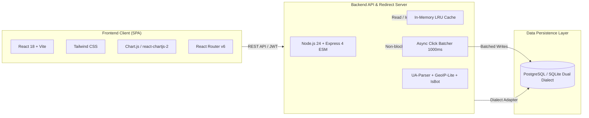

# LinkPulse — Architecture & Flow Diagrams Index

Yeh folder LinkPulse platform ke complete architecture aur process workflows ke visual aur structural diagrams contain karta hai.

---

## 📑 Diagram Documents Index

| Document | Description | Key Focus Areas |
|:---|:---|:---|
| 👥 **[IMPLEMENTATION_ROADMAP.md](file:///c:/Users/ankus/Downloads/haldwani/diagrams/IMPLEMENTATION_ROADMAP.md)** | Team Implementation Matrix & 4-Phase Roadmap | Team contribution swimlanes (Karan, Ankush, Jay, Tarun, Neelesh), Gantt delivery timeline, and codebase mappings across all 4 phases. |
| 💻 **[TECH_STACK_DIAGRAM.md](file:///c:/Users/ankus/Downloads/haldwani/diagrams/TECH_STACK_DIAGRAM.md)** | Full Tech Stack Architecture (Slide / Presentation) | Graphic Era Hill University (Tech Geeks) 5-pillar diagram: Frontend, Backend, Database, Core Libraries, Deployment. |
| 🏛️ **[SYSTEM_ARCHITECTURE.md](file:///c:/Users/ankus/Downloads/haldwani/diagrams/SYSTEM_ARCHITECTURE.md)** | Full System Architecture & Component Topology | Client-Server topology, layered architecture, caching, async batch worker, security boundaries & deployment models. |
| 🗄️ **[DATABASE_ARCHITECTURE.md](file:///c:/Users/ankus/Downloads/haldwani/diagrams/DATABASE_ARCHITECTURE.md)** | Complete Database ER & Schema Architecture | Complete 10-table ER diagram, foreign key constraints, indexing strategies, dual-dialect (SQLite + PostgreSQL) design. |
| 🔄 **[FLOW_DIAGRAMS.md](file:///c:/Users/ankus/Downloads/haldwani/diagrams/FLOW_DIAGRAMS.md)** | End-to-End System Flowcharts & Sequence Flows | 8-step redirect engine pipeline, async click ingestion worker, auth lifecycle, link creation, bio-pages & admin blocklist. |

---

## 🛠️ Technology Stack Summary

---

## 🔗 Quick Reference to Core Code Files
- Server Entry: [server/src/index.js](file:///c:/Users/ankus/Downloads/haldwani/server/src/index.js)
- Express App Setup: [server/src/app.js](file:///c:/Users/ankus/Downloads/haldwani/server/src/app.js)
- Database Schemas: [schema.sqlite.sql](file:///c:/Users/ankus/Downloads/haldwani/server/src/db/schema.sqlite.sql) & [schema.pg.sql](file:///c:/Users/ankus/Downloads/haldwani/server/src/db/schema.pg.sql)
- Redirect Engine: [server/src/routes/redirectRoutes.js](file:///c:/Users/ankus/Downloads/haldwani/server/src/routes/redirectRoutes.js)
- Click Batch Queue: [server/src/services/clickQueue.js](file:///c:/Users/ankus/Downloads/haldwani/server/src/services/clickQueue.js)
- Client Main App: [client/src/App.jsx](file:///c:/Users/ankus/Downloads/haldwani/client/src/App.jsx)
