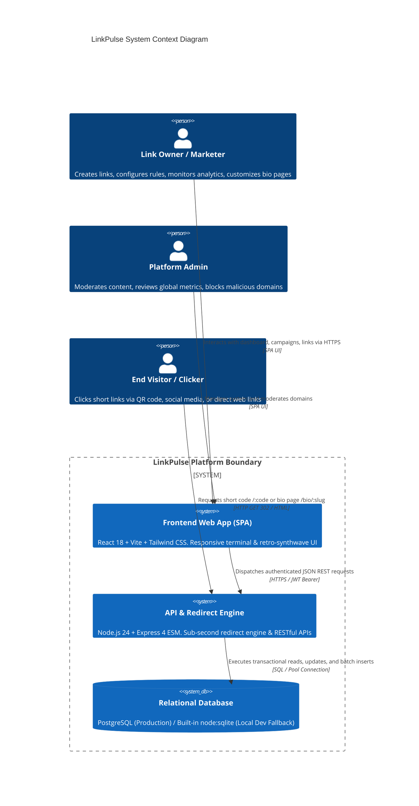

# System Architecture — LinkPulse

Dokumentation LinkPulse platform ke complete system architecture, component relationships, layered design, security boundaries aur deployment topology ko describe karta hai.

---

## 1. High-Level System Context Diagram

Platform do primary user categories ko serve karta hai:
1. **Authenticated Users / Admins**: React SPA ke through URLs manage karte hain, campaigns organize karte hain, analytics visualize karte hain aur domain policies enforce karte hain.
2. **Public Visitors / Clickers**: Short link click karte hain aur sub-second 302 HTTP redirection experience karte hain (with non-blocking click tracking).



---

## 2. Detailed Layered Component Architecture

LinkPulse strict separation-of-concerns follow karta hai:

```mermaid
graph TD
    subgraph ClientLayer["1. Presentation Layer (client/)"]
        UI_Router["React Router v6"]
        UI_Pages["Pages: Dashboard, Links, CreateLink, Organize, Campaigns, Bio, Admin, Import"]
        UI_Components["UI Components: Navbar, StatCard, ChartCards, TerminalLayout, Modal"]
        UI_Lib["API Client (Axios-like fetch) + AuthContext State"]
    end

    subgraph GatewayLayer["2. Gateway & Middleware Layer (server/)"]
        MW_Cors["CORS & Helmet Security Headers"]
        MW_RateLimit["Express Rate Limiter (IP-based protection)"]
        MW_Cookie["Cookie Parser (lp_vid, lp_pw cookies)"]
        MW_Auth["Auth Middleware (JWT verification & Role Guards)"]
        MW_Error["Central Error Handler (asyncHandler & normalized JSON errors)"]
    end

    subgraph ServiceLayer["3. Business Logic & Services Layer (server/src/services/)"]
        S_Auth["authService: Register, Login, Passwords (bcrypt)"]
        S_Link["linkService: Short code gen (nanoid), link CRUD, guards"]
        S_Analytics["analyticsService: Timeseries, geo aggregation, device stats"]
        S_Org["orgService: Campaigns, tags, folders/workspaces"]
        S_Admin["adminService: System metrics, users, domain blocklist"]
        S_Bio["bioService: Bio-page builder & public resolution"]
        S_Import["importService: CSV bulk validation & transactional import"]
        S_Cache["cacheService: In-memory LRU link cache (TTL + bust)"]
        S_Queue["clickQueue: In-memory async batching worker"]
    end

    subgraph EngineLayer["4. Core Engine & Utilities (server/src/utils/)"]
        U_Redirect["Redirect Engine (/routes/redirectRoutes.js)"]
        U_Context["clickContext: UserAgent, GeoIP, Bot detection, SHA-256 IP hash"]
        U_Valid["Validation: Zod schemas & domain safety checks"]
        U_Pages["Branded Fallback Pages (404, 410 Expired, 410 Limit, 401 Password, 403 Blocked)"]
    end

    subgraph PersistenceLayer["5. Data Access & Storage Layer (server/src/db/)"]
        DB_Adapter["Dialect Adapter: query(), queryOne(), run(), transaction()"]
        DB_Sqlite["node:sqlite (Zero-dep built-in local development)"]
        DB_Postgres["pg Driver (High-concurrency cloud production)"]
    end

    %% Wiring
    UI_Lib -->|HTTP/REST| GatewayLayer
    GatewayLayer --> ServiceLayer
    U_Redirect --> S_Cache
    U_Redirect --> U_Context
    U_Redirect --> S_Queue
    U_Redirect --> U_Pages
    ServiceLayer --> DB_Adapter
    S_Queue -->|Batched Flush (every 1s / 200 items)| DB_Adapter
    DB_Adapter --> DB_Sqlite
    DB_Adapter --> DB_Postgres
```

---

## 3. Subsystem Breakdown

### 3.1 Redirect Engine Subsystem
- **Speed & Latency Optimization**: Short link requests (`GET /:code`) directly bypass standard REST overhead. In-memory LRU cache check hota hai prior to DB queries.
- **Async Non-blocking Click Processing**: Click tracking database write redirect response ko block nahi karta. Response turant `302 Found` emit karta hai jabki event in-memory batch queue me enqueue hota hai.
- **Fail-safe Terminal Fallback Pages**: Inactive, expired, password-protected, limit-reached, ya blocked links ke liye custom lightweight HTML error pages serve hote hain with `Cache-Control: no-store`.

### 3.2 Async Click Ingestion & Analytics Pipeline
- **Enrichment on Arrival**: Request headers se `ua-parser-js` device/OS/browser extract karta hai, `geoip-lite` country/city locate karta hai, aur `isbot` search crawlers ko filter out karta hai.
- **Privacy-First Tracking**: User ka raw IP store nahi hota; SHA-256 salted hash store kiya jata hai with rotating or constant server salt.
- **Micro-Batching Engine**: Events in-memory queue me buffer hote hain. Trigger conditions:
  - Timer: har **1,000 ms** (1 second) par batch flush hota hai.
  - Capacity: **200 events** reach hone par immediate premature flush hota hai.
  - Graceful Shutdown: `SIGTERM` / `SIGINT` par remaining queue drain hoti hai before process exit.

### 3.3 Database Dialect Abstraction
- Dual-target support across [schema.sqlite.sql](file:///c:/Users/ankus/Downloads/haldwani/server/src/db/schema.sqlite.sql) and [schema.pg.sql](file:///c:/Users/ankus/Downloads/haldwani/server/src/db/schema.pg.sql).
- Adapter unified parameter syntax provide karta hai (`?` placeholders are dynamically transformed into `$1, $2...` when connected to PostgreSQL).
- In-transaction guarantees for atomic counter increments and bulk link insertions.

---

## 4. Deployment Topology

```mermaid
graph TB
    subgraph Local["Local Development Environment"]
        L_Browser["Developer Browser"]
        L_Vite["Vite Dev Server (:5173)"]
        L_Node["Node.js Server (:3001)"]
        L_Sqlite[("Built-in node:sqlite file")]

        L_Browser --> L_Vite
        L_Vite -->|Proxy /api| L_Node
        L_Node --> L_Sqlite
    end

    subgraph Production["Production Cloud Deployment (Render / Netlify / Vercel)"]
        P_Visitor["End Visitor / User"]
        P_CDN["Global Edge CDN / Reverse Proxy"]
        P_Static["Static SPA Host (Netlify / Vercel / Render Static)"]
        P_API["API Web Service (Render / Docker Container)"]
        P_Postgres[("Managed PostgreSQL Cluster")]

        P_Visitor -->|Browse App| P_CDN
        P_CDN --> P_Static
        P_Static -->|API Calls /api/*| P_API
        P_Visitor -->|Short Link Click /:code| P_API
        P_API --> P_Postgres
    end
```



---

## 5. Security & Boundary Rules
1. **Network Security**: CORS restricted to configured origin in production; Helmet sets strict CSP, HSTS, frameguard, and referrer policy.
2. **Rate Limiting**: Public endpoints and redirect routes guarded against volumetric DoS.
3. **Malware / Phishing Protection**: Centralized domain blocklist table [blocked_domains](file:///c:/Users/ankus/Downloads/haldwani/server/src/db/schema.sqlite.sql#L86) checked during link creation and actively verified during redirect lookup.
4. **Data Isolation**: Workspaces, campaigns, tags, and links strictly scoped by `owner_id`. Admin role required for moderation endpoints.
