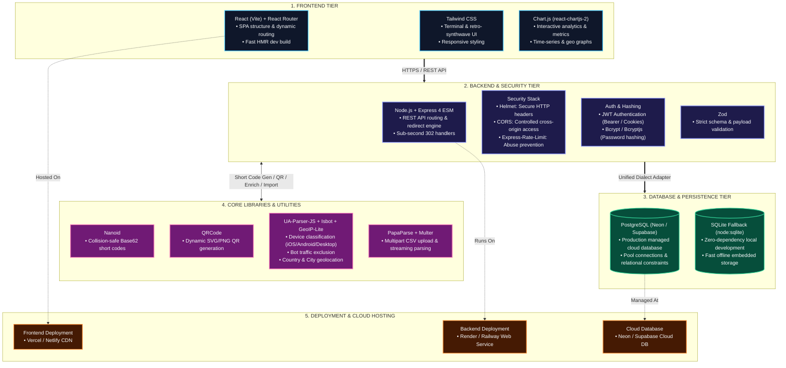
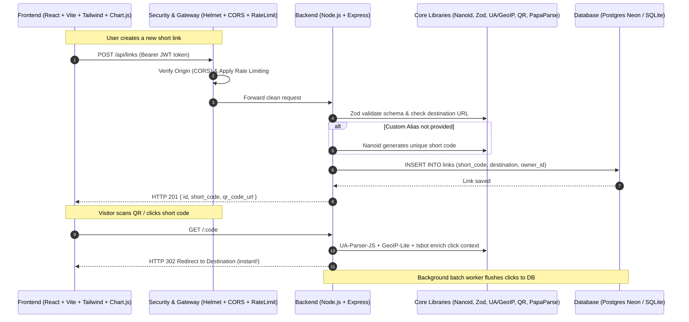

# Tech Stack Architecture Diagram — Graphic Era Hill University (Tech Geeks)

Dokumentation slide aur presentation specs ke basis par LinkPulse platform ke **Full Tech Stack Diagram**, component breakdown aur deployment topography ko present karta hai.

---

## 1. Master Tech Stack Visual Diagram

---

## 2. Interactive Data & Request Flow Across the Stack

---

## 3. Tech Stack Matrix & Implementation Mapping

### 1. Frontend
| Technology | Role & Purpose | Repository Location |
|:---|:---|:---|
| **React (Vite)** | High-performance Single Page Application (SPA), lightning-fast Hot Module Replacement | [client/package.json](file:///c:/Users/ankus/Downloads/haldwani/client/package.json), [client/vite.config.js](file:///c:/Users/ankus/Downloads/haldwani/client/vite.config.js) |
| **React Router** | Client-side routing across Dashboard, Links, Campaigns, Folders, Bio, Admin | [client/src/App.jsx](file:///c:/Users/ankus/Downloads/haldwani/client/src/App.jsx) |
| **Tailwind CSS** | Custom cyberpunk/retro-synthwave UI, dark mode palette, responsive design tokens | [client/tailwind.config.js](file:///c:/Users/ankus/Downloads/haldwani/client/tailwind.config.js), [client/src/index.css](file:///c:/Users/ankus/Downloads/haldwani/client/src/index.css) |
| **Chart.js** | Time-series click graphs, country choropleths, device breakdown donut charts | [client/src/pages/Dashboard.jsx](file:///c:/Users/ankus/Downloads/haldwani/client/src/pages/Dashboard.jsx), [client/src/pages/LinkDetail.jsx](file:///c:/Users/ankus/Downloads/haldwani/client/src/pages/LinkDetail.jsx) |

---

### 2. Backend
| Technology | Role & Purpose | Repository Location |
|:---|:---|:---|
| **Node.js + Express** | High-concurrency asynchronous runtime & RESTful API server with sub-second redirect engine | [server/src/index.js](file:///c:/Users/ankus/Downloads/haldwani/server/src/index.js), [server/src/app.js](file:///c:/Users/ankus/Downloads/haldwani/server/src/app.js) |
| **JWT Authentication** | Stateless JWT tokens (7-day validity) for authorized dashboard & administrative sessions | [server/src/middleware/auth.js](file:///c:/Users/ankus/Downloads/haldwani/server/src/middleware/auth.js), [server/src/services/authService.js](file:///c:/Users/ankus/Downloads/haldwani/server/src/services/authService.js) |
| **Bcrypt / Bcryptjs** | Cryptographic salted hashing (10 rounds) for user credentials and link passwords | [server/src/services/authService.js](file:///c:/Users/ankus/Downloads/haldwani/server/src/services/authService.js), [server/src/routes/redirectRoutes.js](file:///c:/Users/ankus/Downloads/haldwani/server/src/routes/redirectRoutes.js) |
| **Zod** | Declarative runtime validation for user inputs, aliases, URLs, and device targeting rules | [server/src/utils/validation.js](file:///c:/Users/ankus/Downloads/haldwani/server/src/utils/validation.js) |
| **Helmet** | Strict CSP, HSTS, X-Content-Type-Options, Frameguard headers | [server/src/app.js](file:///c:/Users/ankus/Downloads/haldwani/server/src/app.js#L26) |
| **CORS** | Origin whitelisting between frontend domain and backend API | [server/src/app.js](file:///c:/Users/ankus/Downloads/haldwani/server/src/app.js#L27) |
| **Express-Rate-Limit** | Volumetric brute-force and DoS protection for auth and redirect routes | [server/src/app.js](file:///c:/Users/ankus/Downloads/haldwani/server/src/app.js#L29) |

---

### 3. Database
| Technology | Role & Purpose | Repository Location |
|:---|:---|:---|
| **PostgreSQL (Neon / Supabase)** | High-throughput cloud SQL database with connection pooling and relational integrity | [server/src/db/schema.pg.sql](file:///c:/Users/ankus/Downloads/haldwani/server/src/db/schema.pg.sql), [server/src/db/index.js](file:///c:/Users/ankus/Downloads/haldwani/server/src/db/index.js) |
| **SQLite Fallback** | Built-in Node 24 zero-dependency `node:sqlite` for fast offline development | [server/src/db/schema.sqlite.sql](file:///c:/Users/ankus/Downloads/haldwani/server/src/db/schema.sqlite.sql), [server/src/db/index.js](file:///c:/Users/ankus/Downloads/haldwani/server/src/db/index.js) |

---

### 4. Core Libraries
| Library | Role & Purpose | Repository Location |
|:---|:---|:---|
| **Nanoid** | URL-friendly, collision-safe Base62 short alphanumeric code generator | [server/src/utils/shortCode.js](file:///c:/Users/ankus/Downloads/haldwani/server/src/utils/shortCode.js) |
| **QRCode** | Generates crisp vector SVG and high-resolution PNG QR codes with error correction | [server/src/routes/qrRoutes.js](file:///c:/Users/ankus/Downloads/haldwani/server/src/routes/qrRoutes.js) |
| **UA-Parser-JS** | Parses `User-Agent` to determine client device class (`ios`, `android`, `desktop`), OS, and browser | [server/src/utils/clickContext.js](file:///c:/Users/ankus/Downloads/haldwani/server/src/utils/clickContext.js) |
| **Isbot** | Detects and tags web crawlers, search bots, and monitoring pingers to keep analytics clean | [server/src/utils/clickContext.js](file:///c:/Users/ankus/Downloads/haldwani/server/src/utils/clickContext.js) |
| **GeoIP-Lite** | Fast, local offline IP-to-Country and IP-to-City geographical coordinate resolution | [server/src/utils/clickContext.js](file:///c:/Users/ankus/Downloads/haldwani/server/src/utils/clickContext.js) |
| **PapaParse + Multer** | Streaming multipart CSV uploads for bulk link import with live validation preview | [server/src/services/importService.js](file:///c:/Users/ankus/Downloads/haldwani/server/src/services/importService.js), [server/src/routes/linkRoutes.js](file:///c:/Users/ankus/Downloads/haldwani/server/src/routes/linkRoutes.js) |

---

### 5. Deployment
| Platform | Target Component | Configuration File |
|:---|:---|:---|
| **Vercel / Netlify** | Frontend React SPA CDN deployment with rewrite rules for client routing | [client/vercel.json](file:///c:/Users/ankus/Downloads/haldwani/client/vercel.json), [netlify.toml](file:///c:/Users/ankus/Downloads/haldwani/netlify.toml) |
| **Render / Railway** | Backend Node.js Express web service container | [render.yaml](file:///c:/Users/ankus/Downloads/haldwani/render.yaml) |
| **Neon / Supabase** | Managed Serverless PostgreSQL instance with automated migrations | Configured via `DATABASE_URL` in [server/src/config.js](file:///c:/Users/ankus/Downloads/haldwani/server/src/config.js) |
